<p align="center">
  
</p>

<p align="center">
  <a href="https://www.linkedin.com/in/ahmed-samir-sakr-/"></a>
  <a href="mailto:ahmedsamirsakr50@gmail.com"></a>
  <a href="https://wa.me/201030094711"></a>
  <a href="https://drive.google.com/file/d/1dp-b_hNnh9tPMFHJWn_AAogIBleHTaVY/view?usp=sharing"></a>
  
</p>

<br/>

<p align="center">
  Full-stack engineer with 3+ years of building production systems across<br/>
  FinTech, payments, LegalTech and AI — from the database to the UI.
</p>

<br/>


<br/><br/>

```csharp
public sealed class AhmedSamir : SoftwareEngineer
{
    public string[] Backend  => [".NET", "Node.js", "SQL Server"];
    public string[] Frontend => ["Angular", "React", "React Native"];
    public string[] Builds   => ["FinTech", "Payments", "LegalTech", "AI"];
    public string[] Quality  => ["Unit Tests", "Integration Tests"];
    public string   Learning => "System Design at scale";
}
```

<br/>

<p align="center">
  
</p>

<br/>



<br/>

<p align="center">
  <sub><i>Great software isn't luck — it's engineered.</i></sub>
</p>
