<p align="center">
  
</p>

<p align="center">
  <a href="https://www.linkedin.com/in/ahmed-samir-sakr-/"></a>
  <a href="mailto:ahmedsamirsakr50@gmail.com"></a>
  <a href="https://wa.me/201030094711"></a>
  <a href="https://drive.google.com/file/d/1dp-b_hNnh9tPMFHJWn_AAogIBleHTaVY/view?usp=sharing"></a>
  
</p>

<br/>

<h3 align="center">I build the software businesses run on.</h3>
<p align="center">
  3+ years shipping production systems end-to-end — from the database to the last pixel.<br/>
  Architecture-first, performance-obsessed, and always building for real users.
</p>

<br/>


<br/><br/>

```csharp
public sealed class AhmedSamir : SoftwareEngineer
{
    public string[] Stack        => [".NET", "C#", "Angular", "TypeScript", "SQL Server"];
    public string[] Architecture => ["Clean Architecture", "CQRS", "DDD", "Event-Driven"];
    public string[] Domains      => ["FinTech", "Equity", "Governance", "LegalTech", "AI"];
    public string   Focus        => "Scalable, secure systems that ship.";
    public bool     OpenToWork   => true;
}
```

<br/>

<p align="center">
  
</p>

<br/>

<p align="center">
  
  
</p>

<br/>

<p align="center">
  <sub><i>Great software isn't luck — it's engineered.</i></sub>
</p>
